# **PCB**设计安全规范笔记

没有经过深思熟虑设计的电路板冒烟可谓是家常便饭，本文整理了一系列简单电路或者设计规范来让设计规范化，安全化。值得注意的是这里的方案更针对机器人控制器等需要稳定运行的设备（高电流、低压），而非追求低成本的项目，所以方案未必最简！

## 电路设计

### 防烧设计

#### 防反接

串联二极管是最简单的方案 但是会有固定0.5-0.7V的压降 这在使用电池供电和大电流供电的情况是致命的

0.7V * 10A 轻松冒烟好吧

[防反接电路第1篇——二极管保护方案 - FBshark - 博客园](https://www.cnblogs.com/FBsharl/p/18947050)

这篇文章介绍了MOS管的方案

[防反接电路第2篇——MOS管防反接电路 - FBshark - 博客园](https://www.cnblogs.com/FBsharl/p/18947102)

省流：

下图中PMOS负责导通控制，当电流方向正确时，D10稳压二极管将Vgs电压差稳定在钳位电压，R52电阻用于限流（限制二极管的电流和PMOS的驱动电流），两者组合作用避免Vgs过大击穿MOS管，

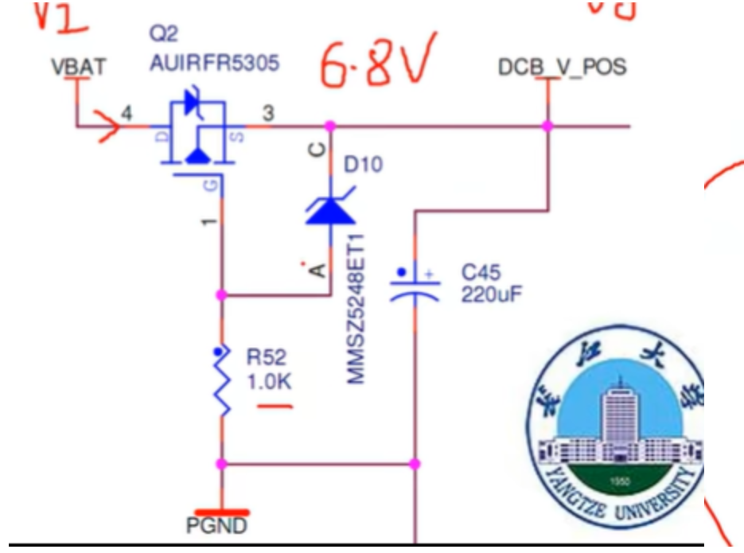

#### 防短路（过流保护）

最暴力的打法 使用贴片自恢复保险丝 选择合适的电流 （自身有一定电阻 会发热）

#### 防静电

**CAN**

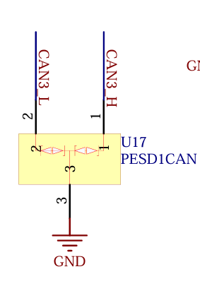

下图其实是防倒灌的一部分

F9 和F10是自恢复保险丝 D1 D2保证CANH CANL侧的电压不会因为外部意外接到0V以下的电压导致MCU烧毁

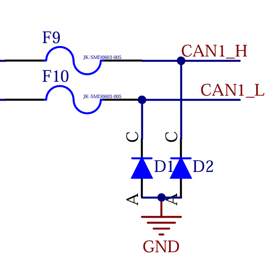

485类似 去掉了共模滤波器，其他结构和CAN差不多

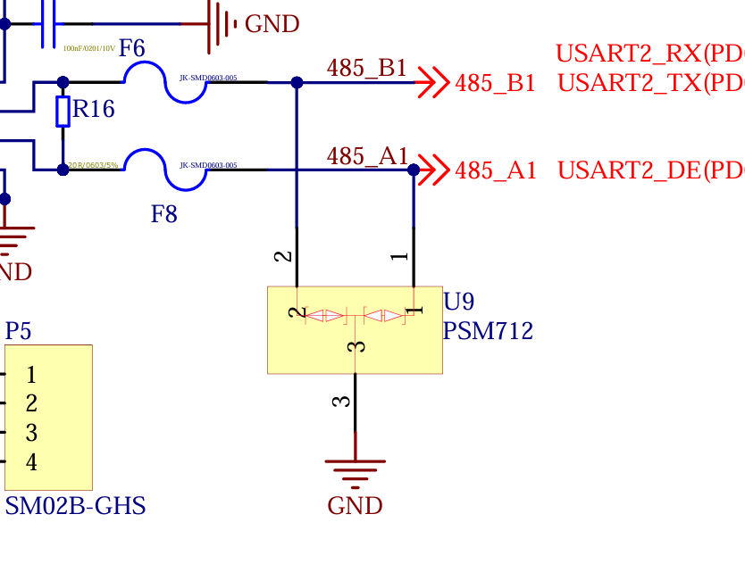

**GPIO输出**

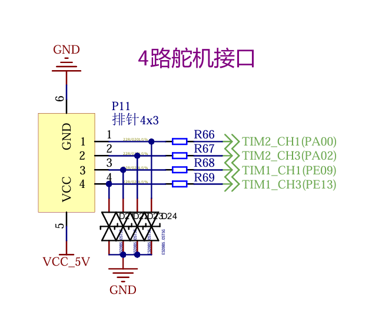

**串口**

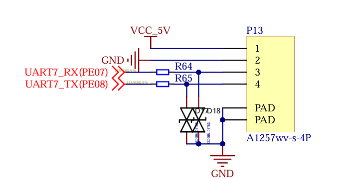

**USB** ([PRTR5V0U2X中文资料_最新报价_数据手册下载_元基-静电和浪涌保护(TVS/ESD)-立创商城](https://item.szlcsc.com/309792.html))

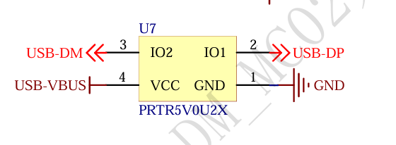

此外USB DP DN也要接22R电阻

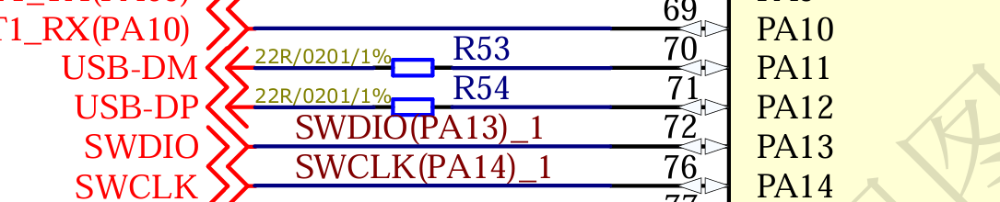

可以看到对外的所有GPIO都使用了ESD放电管和22R电阻 最大程度兼顾**静电防护、信号完整性、电气安全**以及**系统可靠性**

#### 防倒灌

### 稳定性设计

#### 抗干扰

##### 差分信号抗干扰

**CAN**

可以使用共模滤波器ACT45B 

注意工作频率需要大于CAN信号频率来适配CAN FD

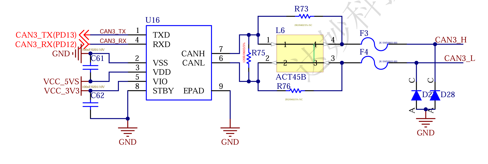

**USB**

也可以使用USB专用的共模滤波器（有ESD和共模滤波器集成在一起的芯片）

USB2.0和3.0的工作频率不同 对应的共模滤波器也不同

##### 信号隔离

有的时候对方的地电压干扰很大，我们可以通过对信号和供电的彻底隔离来避免串扰

**CAN**

来自TI的**ISO1050**是一款集成了隔离的CAN控制器芯片 但是需要额外配置一个5V隔离电源模块

注意这款只支持1mbps的CAN

[ISO1050DUBR中文资料_最新报价_数据手册下载_TI(德州仪器)-隔离式CAN收发器-立创商城](https://item.szlcsc.com/17110.html?fromZone=s_s__%22iso1050%22&spm=sc.gbn.xh1.zy.n___sc.it.ss&lcsc_vid=FFdaXgcEQQRbA1RURFkNUwZSEwVfVwJVFlBXVgdXRVMxVlNeR1lWUFdRQVJWVjsOAxUeFF5JWAgaAglIBBsCBBcFWQIBCktfQ1hfUUoOAwwC)

[使用 ISO1050 和 SN6501 的隔离式 CAN 解决方案 (Rev. B)](https://www.ti.com.cn/cn/lit/an/zhcabs3b/zhcabs3b.pdf?ts=1780887401608&ref_url=https%3A%2F%2Fcn.bing.com%2F)

来自TI的**ISO1042**支持5mbps的CAN FD 封装比ISO1050小

[ISO1042DWVR中文资料_最新报价_数据手册下载_TI(德州仪器)-隔离式CAN收发器-立创商城](https://item.szlcsc.com/2763629.html?fromZone=s_s__%22ISO1042%22&spm=sc.gbn.xh1.zy.n___sc.it.ss&lcsc_vid=FFdaXgcEQQRbA1RURFkNUwZSEwVfVwJVFlBXVgdXRVMxVlNeR1lWUFdRQVJWVjsOAxUeFF5JWAgaAglIBBsCBBcFWQIBCktfQ1hfUUoOAwwC)

**USB**

常见的方案是亚德诺**ADUM3160**+5V隔离电源模块 成本40+

[ADUM3160BRWZ-RL中文资料_最新报价_数据手册下载_ADI(亚德诺)-隔离式USB芯片-立创商城](https://item.szlcsc.com/270193.html?fromZone=s_s__%22ADUM3160%22&spm=sc.gbn.xh1.zy.n___sc.gbn.hd.ss&lcsc_vid=FFdaXgcEQQRbA1RURFkNUwZSEwVfVwJVFlBXVgdXRVMxVlNeR1lWUFdRQVJWVjsOAxUeFF5JWAgaAglIBBsCBBcFWQIBCktfQ1hfUUoOAwwC)

国产化方案有WCH的**CH318T** 需要两颗芯片 +5V隔离电源模块 一发一收 成本30+

[CH318T中文资料_最新报价_数据手册下载_WCH(南京沁恒)-隔离式USB芯片-立创商城](https://item.szlcsc.com/44314366.html?fromZone=s_s__%22ch318t%22&spm=sc.gbn.xh1.zy.n___sc.gbn.hd.ss&lcsc_vid=FFdaXgcEQQRbA1RURFkNUwZSEwVfVwJVFlBXVgdXRVMxVlNeR1lWUFdRQVJWVjsOAxUeFF5JWAgaAglIBBsCBBcFWQIBCktfQ1hfUUoOAwwC)

#### 散热

#### 天线

合理的天线设计需要:

1.平滑的阻抗(线宽)

2.完整的（回流）地平面

3.合理的元器件间隔

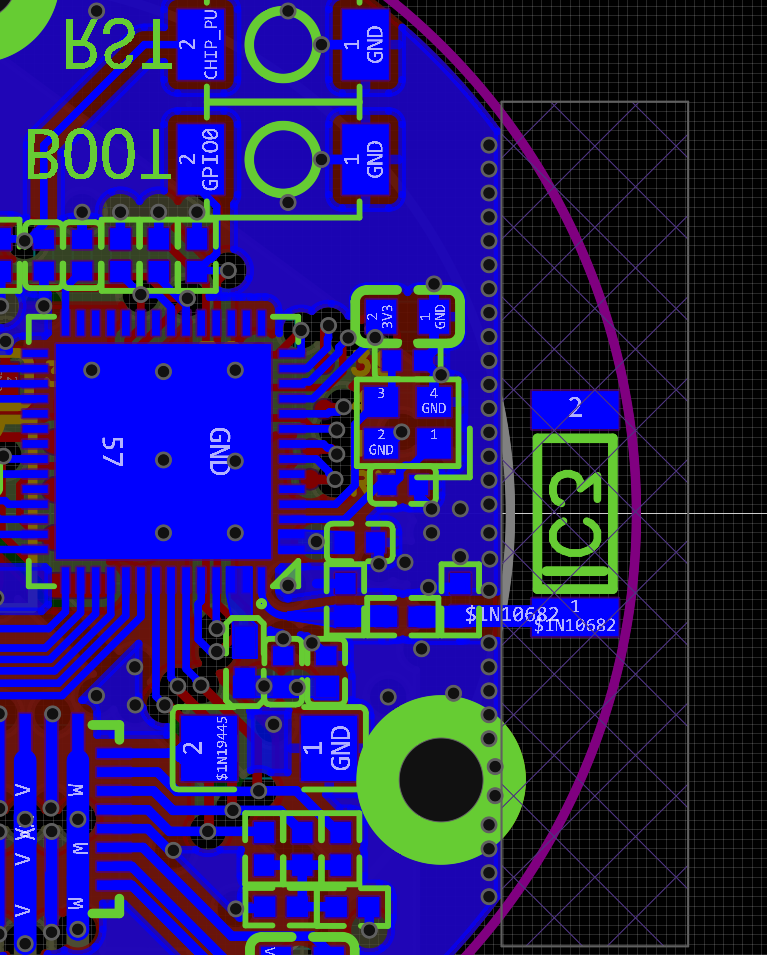

注意C3是一个贴片2.4G天线 芯片的引脚通过一个90°圆弧从下方拐到右侧 理论上整条线路的线宽不应该发生变化 但考虑到采用了0402贴片元器件 在经过第一个Π型滤波器时将线宽逐渐放大，确保后续线宽不变 天线线路附近适当打孔确保地平面连续

贴片天线附近2mm均禁止铺铜 且铺铜边缘均打上一排过孔确保地平面连续且形成屏蔽

原则上晶振等高频噪声源应当避开天线

测试时，可以在Π型滤波器上焊接0欧电阻 使用VNA测试仪测试阻抗 通过史密斯圆图来匹配电容电感

同样的电路下，4层板的效果就是比2层板的信号好，在第三层放置一个完整的地平面起到了良好作用

相反，2层板的地平面被各种线路和元器件割裂 地回流差。

淘宝上低价的ESP32C3 Mini开发板有很多就是Wifi信号差，无法连接Wifi，但是使用手指触摸天线附近又能正常连接。这是因为原本采用了2层板地平面完整度差，但手指可以作为一个地平面，和天线恰好耦合。非常神秘

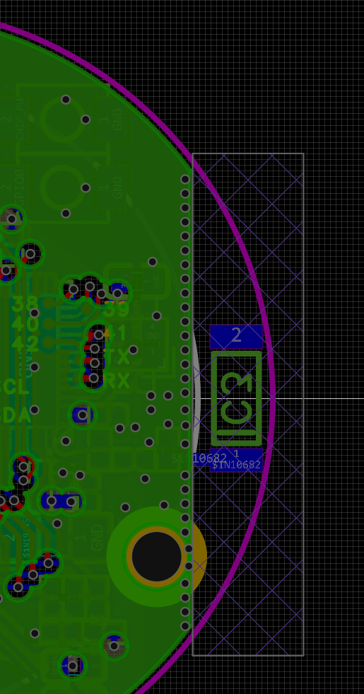

### 元器件

#### 共模滤波器

共模滤波器适用于差分信号的滤波例如CAN、USB

选型需要注意

1. **确定信号速率**
   查找接口规范（如 USB 2.0 是 480 Mbps），这是所有选择的基础。
2. **评估频率和阻抗**
   - **频率匹配**：选择滤波器的 **截止频率 (Cut-off Frequency)** 需**远高于**信号的基频，以确保有用信号通过。
   - **高阻抗阻挡**：确保在您需要滤除的干扰频率点（如 WiFi 的 2.4GHz 或 5GHz），滤波器能提供**足够高的共模阻抗 (Zcm)** 来阻挡噪声
3. **评估信号损伤 (Sdd21)**
   这是核心性能指标，值越接近 0dB 越好。对于超高速接口（如 USB 3.x），需确保在接口基频点（如 USB 3.0 的 2.5GHz），滤波器的 Sdd21 应大于 -3dB（即衰减小于 3dB）。典型高端滤波器的 -3dB 带宽可达 7.6GHz 至 10.7GHz 以上。
4. **确认直流规格**
   - **额定电流 (Ir)**：对于 **USB VBUS 电源线**上的共模滤波器，其额定电流必须大于接口的最大工作电流，并保留足够余量（如推荐 **2 倍余量**），以防止磁芯饱和而失效。
   - **直流电阻 (DCR)**：DCR 越低越好，以减少发热和电压降。对于 **MCU GPIO** 等低速信号，DCR 要求不严格；但对于大电流电源或高精度模拟信号，需格外关注。

#### ESD二极管

TVS/ESD二极管能够防止静电浪涌对芯片的冲击 ，它遇到高压会击穿自己，将高压导入地平面。

ESD二极管有分立式的也有类似排阻的集成式的 选型ESD需要注意

- **VRWM (反向截止电压)**：二极管的VRWM必须**略高于**线路的最高工作电压。例如，5V系统选5V或更高，3.3V系统选3.3V即可。但不宜过高，以免影响保护效果。
- **Cj (结电容)**：决定信号完整性。电容越低，对高速信号的衰减越小，过高的电容会导致信号失真。
- **VC (钳位电压)**：VC必须**低于**被保护芯片所能承受的最大电压（如I/O耐受电压），且越低越好。
- **VBR (击穿电压)**：ESD动作的启动电压。通常略高于VRWM，选择时无需过分关注，但要确保和VRWM一起构成了合适的保护窗口。
- **IPP (峰值脉冲电流)**：体现抗冲击能力。需要根据产品所需的防静电等级（如IEC 61000-4-2标准 Level 4）来挑选能承受对应电流的型号。
- **IR (反向漏电流)**：关乎低功耗设计。在正常工作电压下，IR应尽可能小，以避免不必要的功耗。

1.分立式

2.USB信号/HDMI

3.USB供电+信号

 ([PRTR5V0U2X中文资料_最新报价_数据手册下载_元基-静电和浪涌保护(TVS/ESD)-立创商城](https://item.szlcsc.com/309792.html))

#### MOS

下图是一个单片机GPIO控制大功率电机供电的电路 其中Q5放大电流 D6钳制驱动电压

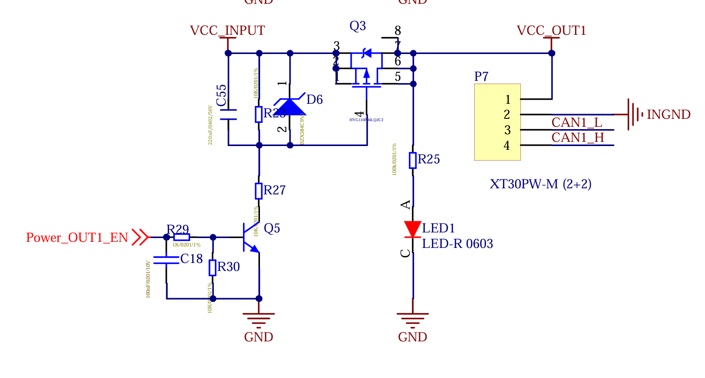
