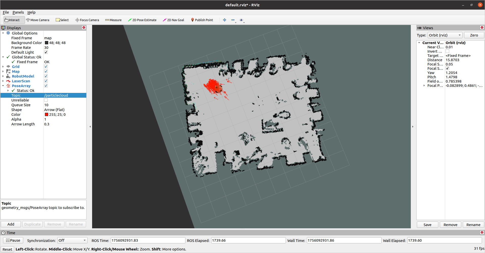

# 启动建图指引备忘

## 1.cartographer 建图

1.启动nailong节点，监听里程计 

```
cd ~/nailong_ws
source devel/setup.bash
roslaunch ros_uart_protocol launch_node.launch
```

若节点启动失败则检查USB接口是否连接 串口是否设置正确 默认设置为ACM0 115200

```
ls /dev/tty*
```

2.启动激光雷达节点 /scan 这是激光雷达对应的驱动

```
cd ~/lakibeam_ws
source ./devel/setup.bash
roslaunch lakibeam1 lakibeam1_scan.launch
```

3.启动建图脚本 

```
cd cartographer_ws 
source install_isolated/setup.bash
roslaunch cartographer_ros my_carto.launch
```

如果需要编译 需要用特殊指令

```
catkin_make_isolated --install --use-ninja
```

4.完成后，保存地图

```
cd cartographer_ws 
./finish_slam_2d.sh
```

## 2.gmapping 建图

https://zhuanlan.zhihu.com/p/262287388

1.启动nailong节点

```
cd ~/nailong_ws
source devel/setup.bash
roslaunch ros_uart_protocol launch_node.launch
```

2.启动激光雷达节点 /scan 这是激光雷达对应的驱动

```
cd ~/lakibeam_ws
source ./devel/setup.bash
roslaunch lakibeam1 lakibeam1_scan.launch
```

3.启动gmapping和遥控器节点

```
cd ~/nailong_ws
source devel/setup.bash
roslaunch navi_demo01 gmapping_joy.launch #如果有手柄
roslaunch navi_demo01 gmapping.launch #自己手推车建图
```

## 3.cartographer和gmapping对比

| 特性维度       | Gmapping                                                     |                         Cartographer                         |
| :------------- | :----------------------------------------------------------- | :----------------------------------------------------------: |
| **核心算法**   | **基于粒子滤波的RBPF** (Rao-Blackwellized Particle Filter)   | **基于图优化** (Graph Optimization)，使用子图（Submap）和位姿图（Pose Graph） |
| **回环检测**   | **隐式、局部**。通过粒子集的重采样来纠正轨迹，本质上是一种**短期**的、被动的回环纠正能力。 | **显式、全局**。**主动地**在**全部已完成子图**中搜索回环，通过**分支定界法**快速匹配，并使用**Ceres求解器**进行优化。 |
| **建图精度**   | 在**小规模环境**中表现良好，精度较高。                       | 在**中大规模环境**中精度远超Gmapping，能有效消除累积误差，生成**全局一致**的地图。 |
| **场景规模**   | 适用于**小范围、简单环境**（如单个房间、小型公寓）。环境增大后，粒子耗散问题会导致建图失败。 | 专为**大规模、复杂环境**设计（如整个楼层、大型工厂、多楼层建筑）。 |
| **计算资源**   | **CPU密集型**。粒子数量越多，精度可能越高，但计算成本呈指数级增长。需要精细调节粒子数。 | **内存密集型**。需要保存所有子图数据以供回环检测匹配，内存占用较高，但CPU使用相对平稳。 |
| **实时性**     | 在较小场景中实时性尚可。粒子数设置过高时会显著拖慢算法速度。 | 实时性优秀。通过**多分辨率地图**和**分支定界法**等技巧，高效地完成了全局回环检测。 |
| **传感器要求** | **强烈依赖高质量的里程计**（如轮式里程计）。激光雷达数据用于校正粒子权重。 | **依赖度较低**。能更好地处理里程计不佳或完全缺失的情况（纯激光建图），支持**多传感器融合**（IMU, Odometry）。 |
| **优缺点**     | **优点**： 1. 算法经典，易于理解和上手。 2. 在小环境中速度快、效果不错。 **缺点**： 1. 不适合大场景，必然发生粒子耗散。 2. 严重依赖里程计质量。 3. 无有效的全局回环纠正。 | **优点**： 1. 能构建大规模、全局一致的地图。 2. 回环检测强大，精度高。 3. 支持多传感器，更鲁棒。 **缺点**： 1. 配置和调参较为复杂。 2. 内存占用较高。 3. 算法原理更复杂。 |
| **适用场景**   | **教学演示**、**小型室内机器人**、**对计算资源有限的嵌入式平台**（需严格控制粒子数）。 | **实际应用项目**、**大规模室内外建图**、**自动驾驶领域**、**任何对地图精度和一致性有要求的场景**。 |

经过测试发现，gmapping非常依赖odom里程计数据，一旦轮胎发生打滑，则建图数据会产生严重偏差。同时，gmapping没有回环检测，这导致建图时可能会出现地图重叠、扭曲变形等问题。

1.如果你使用gmapping建图时，小车旋转，地图也跟着旋转并且发生重叠，那么请考虑：1.urdf文件配置是否正确（https://blog.csdn.net/heyyyyyyyi/article/details/128160043）2.里程计是否准确 3.左右轮子的数据有没有搞反！（可以通过rviz观察虚拟小车旋转方向是否与现实一致  4.参考（https://blog.csdn.net/qq_39032096/article/details/121389652）

cartographer建图速度快，准确度高，不依赖odom小车里程计（它甚至能根据激光雷达自己模拟出里程计），有回环检测 。但是挺吃电脑性能的，对于这台2018年购置的锐龙2500U显得有些卡顿，但如果降低小车速度，也是可以用的

1.你可以用手遮挡激光雷达来验证cartographer有没有调用小车的里程计 如果被遮挡后小车坐标乱飘，那么请检查/odom是否正常发布

**纯建图（Mapping）** 阶段，**不需要**配置或运行 `map_server`

### 典型工作流程总结

1. **纯建图**：
   - 运行：`cartographer_node`, `cartographer_occupancy_grid_node`。
   - 它们发布实时地图到 `/map`。
2. **保存地图**：
   - 在建图完成后，运行 `map_saver` **一次**。
   - `map_saver` 订阅当前的 `/map` topic 并保存文件，然后退出。
3. **后续使用地图（导航）**：
   - 运行：`map_server` (加载保存的地图)，`amcl`, `move_base` 等。
   - `map_server` 开始运行，发布静态地图到 `/map`，为导航系统服务。

使用下面命令查看tf树。

```bash
rosrun rqt_tf_tree rqt_tf_tree
```

## 4.AMCL定位

```
cd nailong_ws
roslaunch navi_demo01 map_amcl.launch
```

AMCL定位流程

1.启动激光雷达节点

2.启动nailong节点

3.启动手柄节点

4.启动map server

5.启动amcl

6.在rviz 设置2D pose estimate

7.用手柄跑一跑小车 等待箭头收敛



## 5.Move_base导航

```
cd nailong_ws
roslaunch navi_demo01 navi.launch
```

