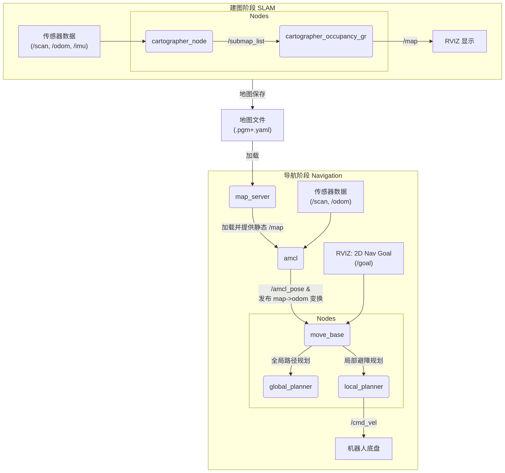
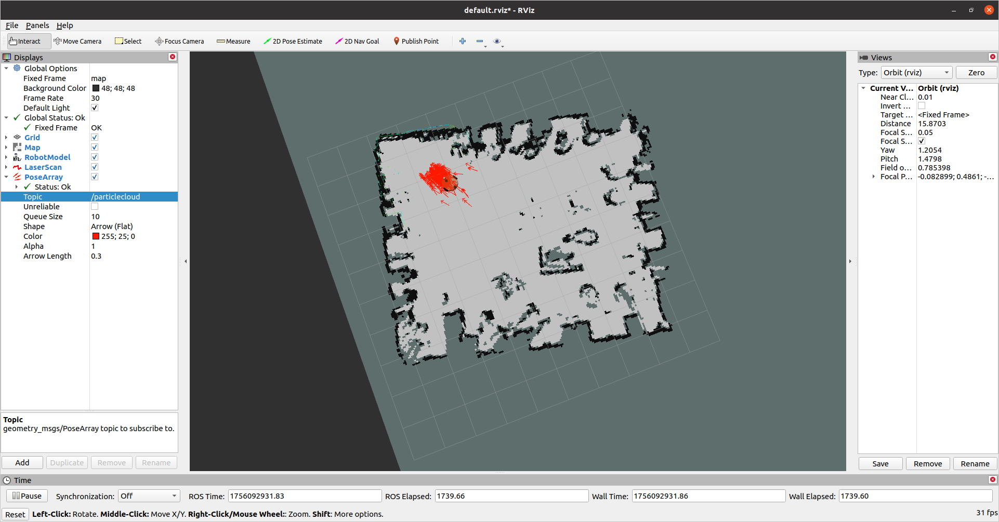

# 从建图到导航

| 阶段                    | 核心节点 & 功能                                              | 关键输入（订阅 Topic/Service）                               | 关键输出（发布 Topic/Service）                               |
| :---------------------- | :----------------------------------------------------------- | :----------------------------------------------------------- | :----------------------------------------------------------- |
| **🗺️ 建图 (SLAM)**       | **`cartographer_node`** SLAM核心算法，处理传感器数据，构建并优化子图（Submap）。 | `/scan` (激光数据) [`/odom`](https://www.yuucn.com/a/1539717.html?from=15425) (里程计) [`/imu`](https://www.yuucn.com/a/1539717.html?from=15425) (IMU数据) | `/submap_list` (子图列表) `/tf` (发布 `base_link` 到 `odom` 或 `map` 的变换) |
|                         | **`cartographer_occupancy_grid_node`** 将子图(Submap)转换为实时占用栅格地图用于显示。 | `/submap_list`                                               | **`/map`** (占用栅格地图)                                    |
| **🧭 导航 (Navigation)** | **`map_server`** **加载**保存好的静态地图到地图服务器。      | - (通过参数加载地图文件)                                     | **`/map`** (静态占用栅格地图)                                |
|                         | **`amcl`** (自适应蒙特卡洛定位) 基于粒子滤波，**在地图中定位**机器人。 | `/scan` (激光数据) `/tf` (坐标变换) `/map` (静态地图) [`/initialpose`](http://www.yuucn.com/a/1525620.html) (初始位姿估计) | `/amcl_pose` (估计的位姿) `/particlecloud` (粒子云) `/tf` (发布 `odom` 到 `map` 的变换) |
|                         | **`move_base`** (导航核心) **完成全局和局部路径规划**，输出速度控制指令。 | `/scan` (激光数据) `/odom` (里程计) `/map` 或 `amcl_pose` (位姿) `/goal` (目标点) | **`/cmd_vel`** (最终的速度控制指令)                          |
|                         | **`global_planner`** (全局规划器) 在全局代价地图上，**计算从当前位置到目标点的全局路径**。 | `/goal` (目标点)                                             | `/global_plan` (全局路径)                                    |
|                         | **`local_planner`** (局部规划器) 在局部代价地图上，**跟随全局路径并实时避障**9。 | `/scan` (实时障碍物信息)                                     | `/cmd_vel` (初步的速度指令)                                  |

------

### 🔧 阶段一：建图 (SLAM with Cartographer)

这个阶段的目标是让机器人探索环境并生成一张准确的地图（通常是`.pgm`和`.yaml`文件）。

1. **启动传感器节点**：首先确保**激光雷达**（`/scan`）、IMU（`/imu`）、**里程计**（`/odom`）等传感器数据正常发布。
2. **启动Cartographer节点**：
   - `cartographer_node`: 这是SLAM的核心。它订阅传感器话题，**持续地进行前端扫描匹配（构建子图Submap）和后端优化（回环检测）**，并发布子图信息。
   - `cartographer_occupancy_grid_node`: 这个节点订阅`/submap_list`，**将所有子图合成一张完整的实时占用栅格地图（OccupancyGrid）**，并发布到`/map`话题上，这样我们就能在Rviz中看到实时构建的地图了。
3. **控制机器人运动**：通过键盘、手柄或其他方式控制机器人在环境中移动，尽可能覆盖所有区域并完成回环。
4. **保存地图**：
   - **完成建图**：调用服务 `rosservice call /finish_trajectory 0` 来终止并优化当前轨迹。
   - **保存状态**：调用服务 `rosservice call /write_state my_map.pbstream` 将Cartographer的**完整内部状态（包括所有子图和位姿约束）** 保存为`.pbstream`文件。这是官方推荐的方式，质量最高。
   - **(可选) 保存栅格地图**：使用 `rosrun map_server map_saver -f my_map` 命令。这**只是对当前`/map`话题的快照**，适用于快速检查，但可能不是最优地图。

> 💡 **关键关系 (建图)**：
>
> - **`cartographer_node`** 是核心，处理数据并生成子图。
> - **`cartographer_occupancy_grid_node`** 依赖于 `cartographer_node` 发布的`/submap_list`，生成用于可视化的`/map`。
> - Rviz **订阅** `/map` 和 `/scan` 等话题进行显示。

------

### 🧭 阶段二：导航 (Navigation with Nav Stack)

这个阶段的目标是让机器人利用上一阶段生成的地图进行自主定位和移动。

1. **加载静态地图**：使用 `map_server` 节点，**加载之前保存的`.yaml`和`.pgm`文件，并将其作为静态地图发布到`/map`话题上**。这与建图时发布的实时`/map`话题是同一类型，但内容不再变化。
2. **启动定位节点 (AMCL)**：启动 `amcl` 节点。AMCL**订阅`/scan`（激光数据）和静态的`/map`，并通过粒子滤波算法来估计机器人在地图中的精确位姿**，发布到`/amcl_pose`，同时发布`odom`坐标系到`map`坐标系的变换。
   - 刚开始时，**需要在Rviz中使用`2D Pose Estimate`按钮告诉AMCL机器人大概的初始位置**，帮助粒子收敛。
3. **启动导航核心 (move_base)**：启动 `move_base` 节点。这是导航的“大脑”，它协调全局和局部规划。
   - **`global_planner`**（全局规划器）：**根据AMCL提供的当前位姿和目标点位置，在全局代价地图上规划一条从起点到终点的全局路径**。
   - **`local_planner`**（局部规划器）：**负责执行全局路径，同时订阅实时`/scan`数据生成局部代价地图，以避免途中出现的未知或动态障碍物**，并生成最终的`/cmd_vel`速度指令。
4. **发送目标点**：在Rviz中**使用`2D Nav Goal`按钮选择一个目标点和方向**。这会将一个目标位姿发送到`move_base`的`/goal`话题。
5. **自主导航**：`move_base`会开始工作，规划路径并控制机器人移动。你可以在Rviz中看到全局路径（通常是一条绿色线）、局部路径（通常是一条蓝色线）和机器人周围的代价地图（障碍物呈红色，空闲区域呈绿色）。

> 💡 **关键关系 (导航)**：
>
> - **`map_server`** 提供不变的静态地图`/map`。
> - **`amcl`** **依赖** `map_server` 提供的`/map`和机器人自身的`/scan`，**计算出`map` -> `odom`` -> `base_link`的坐标变换关系**，这是导航定位的基础。
> - **`move_base`** **依赖** `amcl` 提供的定位结果（通过TF树或`/amcl_pose`）来进行路径规划。
> - **`move_base`** **最终发布`/cmd_vel`** 到机器人的底盘控制器，完成运动控制。
> - 整个系统都**依赖于一个正确且完整的TF坐标树**。

------

### 📊 节点间通信关系图

下图概括了建图和导航两大阶段中，核心节点间通过Topic/Service通信和数据流动的主要关系，希望能帮你建立整体概念。

AMCL定位流程

1.启动激光雷达节点

2.启动nailong节点

3.启动手柄节点

4.启动map server

5.启动amcl

6.在rviz 设置2D pose estimate

7.用手柄跑一跑小车 等待箭头收敛

